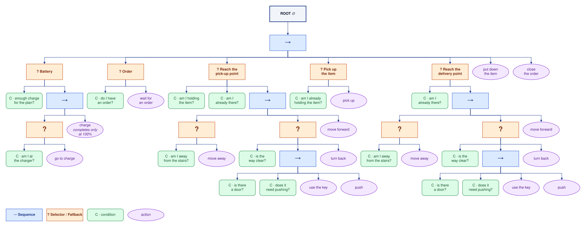

# Autonomous delivery robot with a behavior tree

Simulation of a robot that picks up an item in one room and carries it to
another, driven by a **behavior tree** written with
[py_trees](https://github.com/splintered-reality/py_trees). The robot moves
around the floor plan of a laboratory building, opens doors, keeps away from
the stairs, works around obstacles it discovers along the way and goes to
recharge when the battery is no longer enough.

The simulation can be followed as an animation in the terminal:

```text
╭────────────────────────── Laboratory floor ───────────────────────────╮
│███████████████████████████████████████████████████████████████████████│
│█  r131  █ r129  █ r127  █ r125  █ r123  █ r121  █ r119  █            █│
│█        █       █       █       █       █       █       █            █│
│█        █       █       █       █       █       █       █            █│
│█        █       █       █       █       █       █       █            █│
│█████▒███████▒███████▒███████▒███████▒███████▒███████▒████            █│
│█                                X                            █████████│
│█                                                             █ r117  █│
│█         ██████▒█████████████████████▒██████████████████     ▒       █│
│█         █ lab D                █ lab C                █     █       █│
│█         █                      █                      █     █████████│
│█         █                      █                      █     █ r115  █│
│█         █                      █                      █  B  ▒       █│
│█         █                      █                      █     █       █│
│█    +    █████████████████▒██████████████████████▒██████     █       █│
│█         █                                             █     █████████│
│█         █                                             █     █ r113  █│
│█         █                      █           @          █     ▒       █│
│█         █                      █                      █     █       █│
│█         █ lab A                █ lab B                █     █       █│
│█         ███████████████████▒██████▒█████████████▒██████     █████████│
│█                             x                                       █│
│█                                                                     █│
│█████▒█████≡≡≡≡≡≡≡≡≡█████▒████████▒███████▒███████▒███████▒███████▒████│
│█         █≡≡≡≡≡≡≡≡≡█         █       █       █       █       █       █│
│█         █≡≡≡≡≡≡≡≡≡█         █       █       █       █       █       █│
│█ office  █≡≡stairs≡█  r101   █ r103  █ r105  █ r107  █ r109  █ r111  █│
│███████████████████████████████████████████████████████████████████████│
╰─────────────────── seed 7: start r131, battery 70% ───────────────────╯
╭─────────────────────────────── Status ────────────────────────────────╮
│ tick    9                                                             │
│ battery ████████████░░░░░░░░  59%                                     │
│ order   parcel #1: r131 → c_115                                       │
│ holding parcel #1                                                     │
│ node    lab_b                                                         │
│ tree    Reach the delivery point › To the delivery point › move       │
│         forward                                                       │
│                                                                       │
│ c_129 -> lab_d (63%)                                                  │
│ pushes the door lab_d|lab_a                                           │
│ lab_d -> lab_a (61%)                                                  │
│ lab_a -> lab_b (59%)                                                  │
│                                                                       │
│  @ robot   A pick-up   B delivery   + charger   ▒ closed door   ░     │
│ open door   X obstacle                                                │
╰───────────────────────────────────────────────────────────────────────╯
```

## Quick start

You need [uv](https://docs.astral.sh/uv/) (it installs Python 3.12+ if it is
missing).

```bash
git clone https://github.com/Gabbo1104/autonomous-delivery-robot-behavior-tree.git
cd autonomous-delivery-robot-behavior-tree
uv run tui.py
```

On the first run uv creates the environment and installs the dependencies
(`py_trees`, `rich`).

## Commands

| Command | What it does |
|---|---|
| `uv run tui.py` | animated simulation in the terminal |
| `uv run main.py` | same simulation as a text log |
| `uv run main.py --mostra-albero` | prints the structure of the behavior tree |
| `uv run main.py --stato` | prints the status of every node at every tick |
| `uv run pytest` | runs the tests |

Options shared by `main.py` and `tui.py`:

- `--seed N` replays a simulation exactly (the seed is printed at startup);
- `--batteria N` sets the initial charge (default: random between 1 and 100);
- `--ordini N` number of deliveries (default 1);
- `--ostacoli N` hidden obstacles in the corridors (default 2);
- `--velocita N` `tui.py` only: cells per second (default 12).

The starting point, pick-up point and delivery point are random across the
whole map.

The map needs a terminal at least 73 columns wide. With at least 126 columns
the status panel appears next to the map; in a short terminal the essential
information moves into the map's border.

## The behavior tree



The diagram is drawn in draw.io: [docs/behavior-tree.drawio](docs/behavior-tree.drawio).

`→` is a Sequence (blue), `?` a Selector (orange), `C` a condition (green), and
the purple ovals are actions; children read from left to right. `charge` only
finishes at 100%. All composite nodes are reactive (`memory=False`): on every
tick the tree starts again from the root, so a drop in battery interrupts a
delivery straight away.

## World rules

- **Impassable walls.** The map is a grid; the robot moves from one room to
  another only through doors and never crosses the stairs.
- **One-way doors.** Each door opens in one direction only, as on the floor
  plan. If it opens the way the robot is going, the robot **pushes** it;
  otherwise it would have to pull it and, since it can't, it **uses the key**.
  Doors close again after the robot passes through.
- **Hidden obstacles.** The robot only sees them when it reaches them; it
  remembers them and replans its route.
- **Battery.** Moving and opening doors uses charge. The robot goes to recharge
  when it would have less than 20% left after returning to the charger, and it
  charges up to 100%.

## Project structure

```text
main.py          tree, simulation loop, command line
tui.py           animated terminal view (rich)
mondo.py         robot state, battery, doors, obstacles, orders
mappa.py         node graph and grid with walls and doors
percorso.py      shortest path (Dijkstra)
rami/            one module per branch of the tree
tests/           tests (pytest)
```

## License

[MIT](LICENSE)
