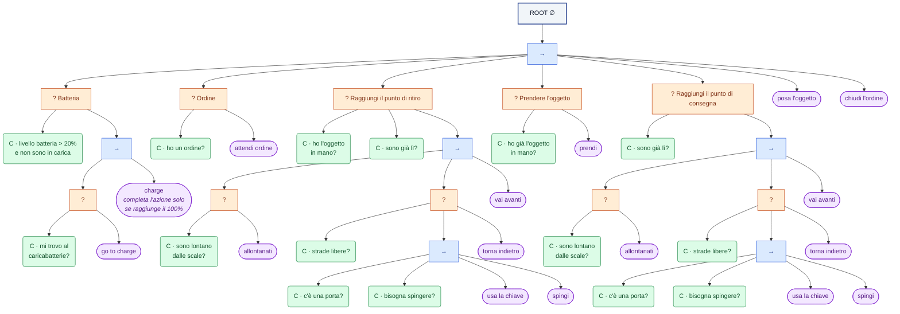

# Robot di consegna autonomo con behavior tree

Simulazione di un robot che prende un oggetto in una stanza e lo porta in
un'altra, guidato da un **behavior tree** scritto con
[py_trees](https://github.com/splintered-reality/py_trees). Il robot si muove
sulla piantina di un piano di laboratorio, apre le porte, evita le scale,
aggira gli ostacoli che scopre lungo la strada e va a ricaricarsi quando la
batteria non basta più.

La simulazione si può seguire animata nel terminale:

```text
╭──────────────────────── Piano del laboratorio ────────────────────────╮
│███████████████████████████████████████████████████████████████████████│
│█  r131  █ r129  █ r127  █ r125  █ r123  █ r121  █ r119  █            █│
│█        █       █       █       █       █       █       █            █│
│█        █       █       █       █       █       █       █            █│
│█        █       █       █       █       █       █       █            █│
│█████▒███████▒███████▒███████▒███████▒███████▒███████▒████            █│
│█                                X                            █████████│
│█                                                             █ r117  █│
│█         ██████▒█████████████████████▒██████████████████     ▒       █│
│█         █ lab D                █ lab C                █     █       █│
│█         █                      █                      █x    █████████│
│█         █                      █                      █     █ r115  █│
│█         █                      █                      █  B  ▒       █│
│█         █                      █                      █     █       █│
│█    +    █████████████████▒██████████████████████▒██████     █       █│
│█         █                     @                       █     █████████│
│█         █                                             █     █ r113  █│
│█         █                      █                      █     ▒       █│
│█         █                      █                      █     █       █│
│█         █ lab A                █ lab B                █     █       █│
│█         ███████████████████▒██████▒█████████████▒██████     █████████│
│█                             x                                       █│
│█                                                                     █│
│█████▒█████≡≡≡≡≡≡≡≡≡█████▒████████▒███████▒███████▒███████▒███████▒████│
│█         █≡≡≡≡≡≡≡≡≡█         █       █       █       █       █       █│
│█         █≡≡≡≡≡≡≡≡≡█         █       █       █       █       █       █│
│█ office  █≡≡scale≡≡█  r101   █ r103  █ r105  █ r107  █ r109  █ r111  █│
│███████████████████████████████████████████████████████████████████████│
╰───────────────── seed 7: partenza r131, batteria 70% ─────────────────╯
╭──────────────────────────────── Stato ────────────────────────────────╮
│ tick     9                                                            │
│ batteria ████████████░░░░░░░░  59%                                    │
│ ordine   pacco #1: r131 → c_115                                       │
│ in mano  pacco #1                                                     │
│ nodo     lab_b                                                        │
│ albero   Raggiungi il punto di consegna › Verso la consegna › vai     │
│          avanti                                                       │
│                                                                       │
│ c_129 -> lab_d (63%)                                                  │
│ spinge la porta lab_d|lab_a                                           │
│ lab_d -> lab_a (61%)                                                  │
│ lab_a -> lab_b (59%)                                                  │
│                                                                       │
│  @ robot   A ritiro   B consegna   + carica   ▒ porta chiusa   ░      │
│ porta aperta   X ostacolo                                             │
╰───────────────────────────────────────────────────────────────────────╯
```

## Avvio rapido

Serve [uv](https://docs.astral.sh/uv/) (Python 3.12+ viene installato da uv se manca).

```bash
git clone https://github.com/Gabbo1104/autonomous-delivery-robot-behavior-tree.git
cd autonomous-delivery-robot-behavior-tree
uv run tui.py
```

Al primo avvio uv crea l'ambiente e installa le dipendenze (`py_trees`, `rich`).

## Comandi

| Comando | Cosa fa |
|---|---|
| `uv run tui.py` | simulazione animata nel terminale |
| `uv run main.py` | stessa simulazione come log testuale |
| `uv run main.py --mostra-albero` | stampa la struttura del behavior tree |
| `uv run main.py --stato` | stampa lo stato di ogni nodo a ogni tick |
| `uv run pytest` | esegue i test |

Opzioni comuni a `main.py` e `tui.py`:

- `--seed N` ripete esattamente una simulazione (il seed viene stampato all'avvio);
- `--batteria N` fissa la carica iniziale (default: casuale tra 1 e 100);
- `--ordini N` numero di consegne (default 1);
- `--ostacoli N` ostacoli nascosti nei corridoi (default 2);
- `--velocita N` solo per `tui.py`: caselle al secondo (default 12).

Partenza, punto di ritiro e punto di consegna sono casuali su tutta la mappa.

La mappa richiede un terminale largo almeno 73 colonne. Con almeno 126 colonne
lo stato compare accanto alla mappa; in un terminale basso le informazioni
essenziali vanno nel bordo della mappa.

## Il behavior tree



`→` è una Sequence (blu), `?` un Selector (arancione), `C` una condizione
(verde), gli ovali viola sono azioni; i figli si leggono da sinistra a destra.
`charge` finisce solo al 100%. Tutti i
nodi composti sono reattivi (`memory=False`): a ogni tick l'albero riparte
dalla radice, quindi un calo di batteria interrompe subito una consegna.

## Regole del mondo

- **Muri invalicabili.** La mappa è una griglia; il robot passa da una stanza
  all'altra solo dalle porte e non attraversa mai le scale.
- **Porte a verso unico.** Ogni porta si apre in una sola direzione, come nella
  piantina. Se si apre nel verso in cui va, il robot la **spinge**; altrimenti
  dovrebbe tirarla e, non potendo, **usa la chiave**. Le porte si richiudono
  dopo il passaggio.
- **Ostacoli nascosti.** Il robot li vede solo quando ci arriva davanti; li
  memorizza e ripianifica il percorso.
- **Batteria.** Muoversi e aprire porte consuma carica. Il robot va a
  ricaricarsi quando gli resterebbe meno del 20% dopo essere tornato al
  caricabatterie, e ricarica fino al 100%.

## Struttura del progetto

```text
main.py          albero, ciclo di simulazione, riga di comando
tui.py           vista animata nel terminale (rich)
mondo.py         stato del robot, batteria, porte, ostacoli, ordini
mappa.py         grafo dei nodi e griglia con muri e porte
percorso.py      percorso più breve (Dijkstra)
rami/            un modulo per ogni ramo dell'albero
tests/           test (pytest)
```

Il codice è commentato in inglese nei dettagli; [main.py](main.py) contiene
anche un glossario dei nomi italiani usati nel codice.

## Licenza

[MIT](LICENSE)
